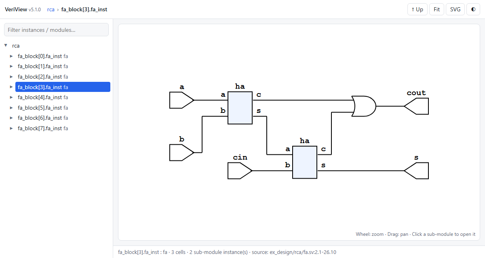
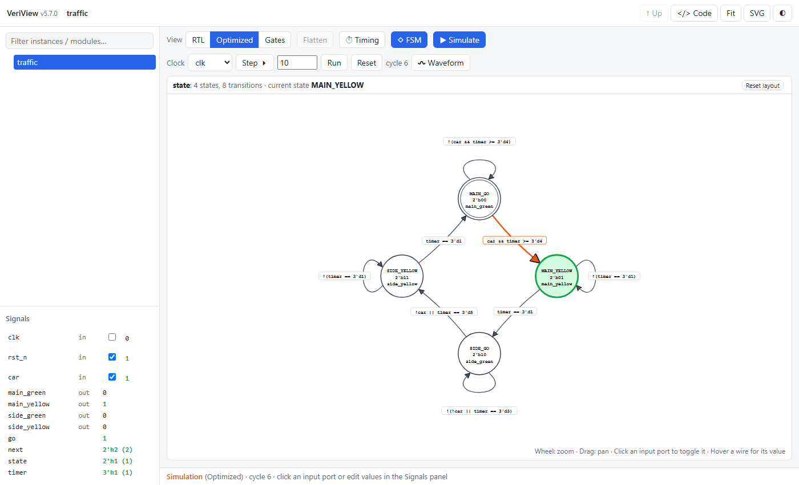
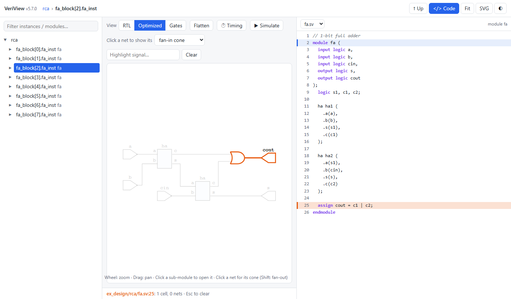
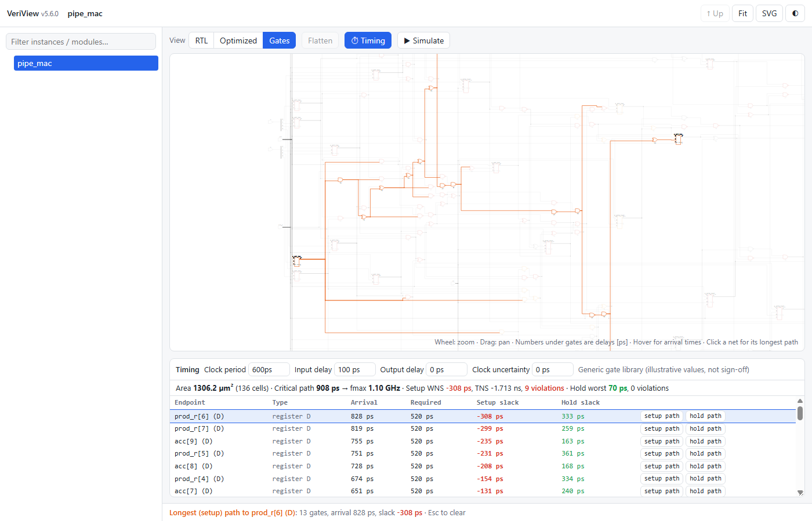
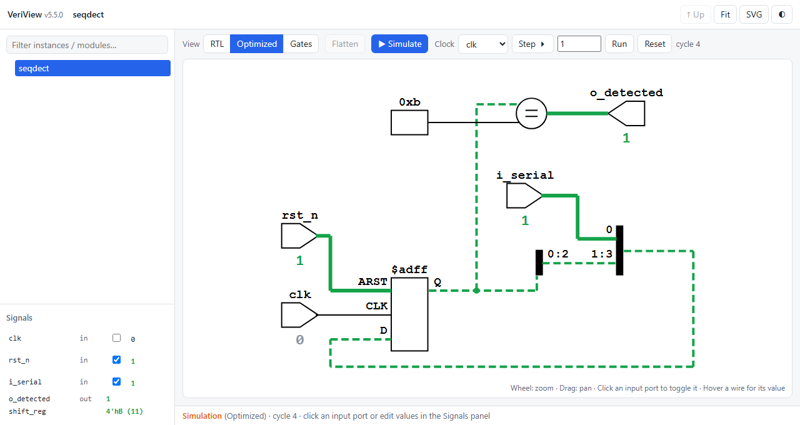
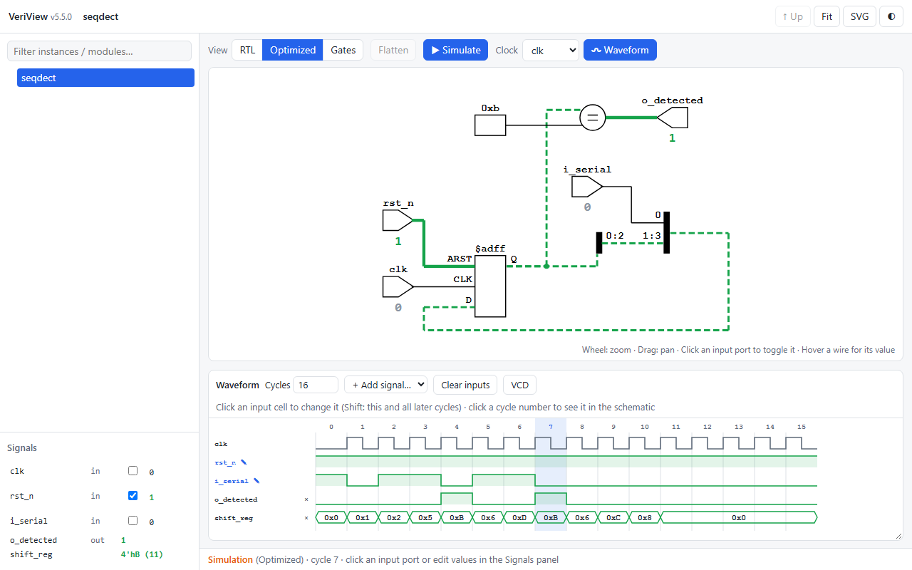

# VeriView

[](https://pypi.org/project/veriview/)
[](https://pypi.org/project/veriview/)
[](https://github.com/recepyazar/veriview/actions/workflows/ci.yml)

**VeriView** turns Verilog and SystemVerilog designs into SVG schematics from the command line.

It wraps **Yosys** and **netlistsvg** (plus, optionally, **sv2v** or **yosys-slang** for full SystemVerilog support): it reads your sources or `.f` file lists, synthesizes a netlist and renders it as an SVG.

## Features

- **Verilog & SystemVerilog** (`.v`, `.sv`) – auto-detected per file.
- **Full SystemVerilog via fallback frontends** – if Yosys' built-in parser can't handle a construct (e.g. unpacked array ports), VeriView automatically retries with [yosys-slang](https://github.com/povik/yosys-slang) or [sv2v](https://github.com/zachjs/sv2v).
- **File lists (`.f`)** – `+incdir+`, `+define+`, nested `-f`/`-F`, `-v`, `$VAR`/`${VAR}`/`$(VAR)` and comments.
- **Include dirs & defines** – `-I` and `-D` on the command line.
- **Interactive HTML viewer** – `--html` writes a single self-contained page: click into sub-modules, switch between RTL / optimized / gate views, flatten any module, and click a net to highlight its fan-in or fan-out cone.
- **State machine diagrams** – FSMs are detected automatically and drawn with their states, encodings, outputs and the original source conditions; in simulation mode the current state lights up.
- **Code ↔ schematic** – the viewer shows the RTL source next to the schematic: click a cell to see the line it came from, click a line to see its cells.
- **Gate-level timing** – gate delays, setup/hold checks, critical path, fmax and area: in the viewer (**⏱ Timing**) or as a report (`--timing 2ns`).
- **Simulation mode** – drive the inputs, clock the design and watch the 1-valued wires light up, right in the schematic (also inside sub-modules).
- **Hierarchy control** – keep sub-modules as boxes or `--flatten` them; `--split` renders one SVG per module.
- **Live mode** – `--watch` rebuilds on every save; with `--html` the viewer is served locally and the browser refreshes by itself.
- **Focus on what matters** – `--select` a sub-instance, expand only `--depth N` levels, or draw just the `--cone` of logic driving a signal.
- **Three views** – `--stage elab` (RTL as written), `opt` (optimized RTL, default) or `gate` (synthesized gates).
- **Dark-mode friendly** – injects a background (`--bg white` by default, `--bg none` to disable).
- **Open the result** – `--open` uses `xdg-open`, macOS `open`, or Windows Explorer on WSL.
- **Optional dependency installer** – `--install-deps` installs Yosys, Node.js, netlistsvg and sv2v.
- **Pure Python, no Python dependencies** – a single `pip install`; also usable as a library.

## Requirements

Python 3.9+ on Linux (Debian/Ubuntu, Fedora, Arch), macOS, WSL or Windows, plus:

| Tool | Needed for |
| :--- | :--- |
| [Yosys](https://github.com/YosysHQ/yosys) | synthesis (required) |
| [netlistsvg](https://github.com/nturley/netlistsvg) + Node.js | rendering (required) |
| [sv2v](https://github.com/zachjs/sv2v) **or** [yosys-slang](https://github.com/povik/yosys-slang) | SystemVerilog beyond Yosys' built-in parser (optional) |

Install whatever is missing with:

```bash
veriview --install-deps      # asks before using sudo; add -y to skip the prompt
```

sv2v is installed without sudo to `~/.local/bin` (Windows: `%LOCALAPPDATA%\veriview\bin`); VeriView finds it there even if that directory is not in `PATH`. If dependencies are missing during a normal run, VeriView asks whether to install them (interactive terminals only). On Windows, install Yosys from the [OSS CAD Suite](https://github.com/YosysHQ/oss-cad-suite-build) and run `npm install -g netlistsvg`.

## Installation

VeriView is on [PyPI](https://pypi.org/project/veriview/). It is a command-line tool, so install it in its own isolated environment with [pipx](https://pipx.pypa.io/) or [uv](https://docs.astral.sh/uv/):

```bash
pipx install veriview          # or: uv tool install veriview
veriview --install-deps        # Yosys, Node.js + netlistsvg, sv2v
```

Upgrade later with `pipx upgrade veriview` (or `uv tool upgrade veriview`).

The latest development version from GitHub:

```bash
pipx install git+https://github.com/recepyazar/veriview.git
```

Or from a clone:

```bash
git clone https://github.com/recepyazar/veriview.git
cd veriview
uv tool install .            # or: pipx install .
```

Both put the `veriview` command in `~/.local/bin`. Plain `pip install` also works inside a virtual environment; on Debian/Ubuntu, `pip install` into the system Python fails with `externally-managed-environment` ([PEP 668](https://peps.python.org/pep-0668/)), which is expected.

`./veriview.sh` still works from a clone without installing (it runs the Python package from `src/`).

## Usage

```bash
veriview design.sv            # opens the interactive viewer (writes design.html)
veriview rtl/                 # a whole folder: its .f file, or all .v/.sv files in it
veriview design.f --watch     # live: the browser reloads whenever you save
veriview design.sv -o x.svg   # a plain SVG schematic instead of the viewer
```

That is all you need day to day: the top module is detected automatically and every feature (views, flatten, timing, FSM diagrams, simulation, source code) is a button in the viewer. The full syntax is

```bash
veriview [options] <input>... [top_module]
```

where `<input>` is one or more `.v`/`.sv` files, `.f` file lists or a folder. The output kind follows `-o`: `name.html` (viewer, default) or `name.svg` (schematic); `--svg` picks the SVG without naming the file. The viewer opens in the browser automatically when no `-o` is given in a terminal (`--open` / `--no-open` to change that).

| Option | Description |
| :--- | :--- |
| `-t`, `--top <name>` | Top module (default: auto-detected). The legacy positional form `veriview design.f top` also works. |
| `-o`, `--output <path>` | Output SVG path (a path ending in `/` is treated as a directory). With `--split`: output directory. |
| `-f`, `-F <file.f>` | Read a file list. |
| `-I`, `--incdir <dir>` | Add an include directory (repeatable). |
| `-D`, `--define <N[=V]>` | Add a preprocessor define (repeatable). |
| `--stage <elab\|opt\|gate>` | What to draw: RTL as written, optimized RTL (default) or gate level. See [Views](#views-elab--opt--gate). |
| `--flatten` | Flatten the hierarchy (expand sub-modules). |
| `--select <inst/path>` | Draw only this sub-instance, with its actual parameters (e.g. `u_core/u_alu`). |
| `--depth <N>` | Expand N levels of hierarchy below the top; deeper sub-modules stay boxes. |
| `--cone <signal>` | Draw only the logic driving `signal`, stopping at registers (repeatable). |
| `--split` | Render every module into its own SVG. |
| `--svg` | Write a plain SVG schematic instead of the HTML viewer. |
| `--html` | Write the HTML viewer (the default; useful to be explicit in scripts). |
| `--fsm` | Print the state machines found in the design (states, encodings, transitions); with `-o file.dot` also write a Graphviz diagram. |
| `--timing <period>` | Print a gate-level static timing report (setup/hold, critical path, fmax, area), e.g. `--timing 2ns` or `--timing 250MHz`. |
| `--input-delay`, `--output-delay`, `--uncertainty` | Timing constraints for `--timing` (defaults `100ps`, `0ps`, `0ps`). |
| `--html-stages <list>` | Views embedded in the HTML viewer (default `elab,opt,gate`; `--stage` is shown first). |
| `--frontend <name>` | `auto` (default), `yosys`, `sv2v` or `slang`. |
| `--skin <file.svg>` | Custom [netlistsvg skin](https://github.com/nturley/netlistsvg#skins). |
| `--bg <color\|none>` | Background color (default `white`). |
| `--keep-json` | Keep the Yosys JSON netlist next to the SVG. |
| `--open`, `--no-open` | Open the result in the browser (default: only the viewer, only without `-o`). |
| `--watch` | Rebuild whenever a source file changes (Ctrl+C to stop). With `--html`, serves the viewer at `http://127.0.0.1:8765/` and reloads the browser automatically. |
| `--port <N>` | Port for `--watch --html` (default 8765; the next free port is used if busy). |
| `--install-deps` | Install missing dependencies. |
| `-y`, `--yes` | Don't ask for confirmation when installing. |
| `-q`, `--quiet` | Only print warnings and errors. |
| `-V`, `--version` / `-h`, `--help` | Version / help. |

> **6.0:** the default output is the HTML viewer (it was an SVG). Use `-o name.svg` or `--svg` for the schematic; `--cone`, `--depth` and `--split` still produce SVGs.
>
> **Breaking change in 4.0:** `-f` now means *file list* (as in other EDA tools). Use `--flatten` to flatten the hierarchy.
>
> **5.0:** VeriView is now a Python package (`veriview` command). Options are unchanged; `veriview.sh` remains as a wrapper. Invalid command-line arguments now exit with code 2.

If `-o` is not given, the output is `<top_module>.svg` (when a top is given) or `<first_input_name>.svg` in the current directory.

### Interactive HTML viewer

```bash
veriview ex_design/rca/rca.f --html --open
```



The output is one HTML file with every module of the design embedded (no internet connection or server needed), so it can be shared or attached as-is. All views are pre-rendered, so every control below works instantly in the browser:

- **Navigate:** click a highlighted sub-module box (or a node in the tree) to open it; **breadcrumbs** and **↑ Up** / `Backspace` go back up. Parameterized modules are labeled with their parameters, e.g. `b2g (WIDTH=3)`.
- **View: RTL / Optimized / Gates** switches between the `elab`, `opt` and `gate` [stages](#views-elab--opt--gate). If the current instance was optimized away in the new view, the viewer says so and shows its nearest parent.
- **Flatten** expands every sub-module of the current module in place.
- **Cones:** click a net to highlight its **fan-in** cone (the logic driving it), **Shift-click** for its **fan-out**, or pick the mode in the toolbar. Clicking a port or a cell works too, and the **Highlight signal…** box finds any named signal. Cones stop at registers (which are still highlighted); buses that only partly belong to a cone are dashed; `Esc` clears. In the hierarchical view a sub-module box is treated as a whole (every input may affect every output) — flatten for an exact cone.
- **Mouse wheel** zooms around the cursor, **drag** pans, **Fit** / `F` fits the schematic to the window, **SVG** downloads the current view.
- The current position and view are kept in the URL (`rca.html#/fa_block[3].fa_inst?stage=gate&flat=1`), so the back button works and links point to a specific view.

Rendering every view takes longer for big designs; use `--html-stages opt` to embed only one view.

### State machine diagrams

VeriView finds state machines with Yosys' FSM extraction and draws them. Press **◇ FSM** in the viewer (enabled for modules that contain one):



- **States** show their name (from an `enum` or from `localparam`s), their encoding and the Moore outputs that are high; the reset state has a double circle. Drag states to rearrange the diagram (the layout is remembered).
- **Transitions** are labelled with the original source expressions (e.g. `car && timer >= 3'd4`); parallel transitions are merged and their conditions simplified.
- **With ▶ Simulate** the current state is highlighted in green and the transition just taken in orange — step the clock or use the waveform panel and watch the FSM move.
- **With </> Code** click a state to see where it is used, or a transition to see the code of its condition.
- **Several FSMs:** a selector switches between the state machines of one module; state machines in sub-modules are listed as links that open them.
- **SVG** downloads the diagram.

On the command line, `veriview design.sv --fsm` prints the states and transitions, and `--fsm -o fsm.dot` writes a Graphviz file.

Notes: VeriView also shows small FSMs that Yosys would normally skip because re-encoding them would not pay off. A register is recognised as a state machine when it is only compared against constants (the usual `case (state)` style; e.g. `if (next == state)` prevents detection). Mealy outputs that are computed outside the state logic are not shown on the transitions. Try the examples `ex_design/fsm/traffic.sv` (Moore, `enum`) and `ex_design/fsm/seq_fsm.v` (Mealy-style, `localparam`, synchronous reset).

### Source code panel

Press **</> Code** to show the source files next to the schematic:



- **Cell → code:** click a cell (or a wire) and its source line is highlighted; opening a sub-module jumps to its `module` definition.
- **Code → cell:** click a line and every cell and net created from it is highlighted. If the line belongs to a module that is not on screen, the viewer opens the first instance of that module.
- Works in every view and mode (also while simulating or in timing mode). In the Gates view, gates inherit the location of the net they drive; with the sv2v frontend the panel shows the converted Verilog.
- If nothing is highlighted, the logic of that line was optimized away — try the RTL view.

### Timing analysis

Press **⏱ Timing** in the viewer (it switches to the Gates view and flattens) for a static timing analysis of the gate-level netlist:



- **Gate delays:** every gate shows its delay in ps under its symbol (flip-flops: clk→Q); hover a gate or a wire for arrival times and slack.
- **Constraints** (live, per design): clock period (`2ns`, `500ps`, `250MHz`), input delay, output delay and clock uncertainty.
- **Setup check** at every flip-flop data pin (D, enable, synchronous reset) and output: the longest path must arrive before *period − setup − uncertainty*.
- **Hold check** at every flip-flop data pin: the shortest path must arrive after *hold + uncertainty*. Increase the clock uncertainty to see hold violations appear.
- **Results:** total area, critical path and fmax, setup WNS/TNS, worst hold slack and the number of violations; gates are coloured by slack (red = violating, orange = within 10 % of the period).
- **Paths:** the endpoint table is sorted by slack; click a row (or *setup path* / *hold path*) to highlight that path and zoom to it, or click any net or gate for the longest path leading to it.

The same analysis on the command line:

```bash
veriview ex_design/pipe_mac.sv --timing 600ps --uncertainty 50ps
```

prints the summary, the worst endpoints and the critical setup and hold paths step by step.

The delay model is deliberately simple: one ideal clock, delay = intrinsic + k × fanout per gate, from a **generic, illustrative library** with values roughly in the range of a 130 nm process — good for learning and for comparing design alternatives, not for sign-off. Asynchronous set/reset pins are not timed. Mapping to a real standard-cell library (sky130) is on the [roadmap](ROADMAP.md).

### Simulation mode

Press **▶ Simulate** in the viewer to turn the schematic into a logic simulator:



- **Inputs:** click an input port in the schematic to toggle it, or edit values in the **Signals** panel (checkbox for 1-bit inputs; buses accept `5`, `0x1F`, `0b101`, `8'hA5`, ...).
- **Clock:** pick the clock input, then **Step** one cycle or **Run** N cycles (Enter in the cycle box also runs); **Reset** clears all registers. You can also toggle the clock port by hand — every rising edge counts as a cycle.
- **Resets:** inputs that drive a register reset start *inactive* (an active-low `rst_n` starts at 1), even through sub-modules. If registers are held in reset, the status line says so, e.g. *"4 registers held in reset by rst_n = 0"*.
- **Watching values:** wires that are 1 turn green (buses that are partly 1 are dashed), every port shows its value, hovering a wire shows its name and value, and the Signals panel lists every named signal of the current module.
- **Hierarchy:** open any sub-module while simulating to see its internal values — each instance has its own state. Works in all three views (RTL / Optimized / Gates).
- Inputs are remembered across reloads (handy with `--watch`).

#### Waveform

Press **〰 Waveform** (in simulation mode) to draw the input stimulus by hand and see the result as a timing diagram:



- **Inputs:** click a cell to toggle that cycle, **Shift-click** to set that cycle and every later one; bus cells ask for a value. Changing an input in the schematic or the Signals panel sets it from the selected cycle onwards.
- **Outputs** are recomputed instantly on every change. Top-level outputs are shown by default; **+ Add signal…** adds any named signal of the top module, **×** removes one.
- **Timing:** each column is one clock cycle. A cycle starts with the rising clock edge (registers capture the inputs of the previous cycle), then that cycle's inputs are applied. With no clock selected, each column is just a time step (useful for combinational designs).
- Click a **cycle number** to see that cycle in the schematic (also inside sub-modules).
- **VCD** downloads the waveform for GTKWave or any other waveform viewer.

How it works and its limits: a two-valued (0/1), cycle-based simulation of the synthesized netlist running in the browser. Registers start at 0 and update on the active edge of their own clock net; asynchronous resets/sets and latches act immediately; undriven, `x` and `z` bits read as 0. It simulates what Yosys built, not the HDL source itself, so there are no delays, `initial` blocks or testbenches. Memories (`$mem`) are not supported yet (the status line lists any unsupported cells). Flattening is disabled while simulating.

### Live mode (`--watch`)

```bash
veriview ex_design/rca/rca.f --html --watch --open
```

VeriView keeps running and rebuilds whenever a source file, a `.f` file list or a file in an include directory changes:

- With `--html`, the viewer is served on a local web server (`http://127.0.0.1:8765/`, only reachable from your machine) and the **browser reloads by itself** after each rebuild — staying on the same instance, view and flatten state.
- If a rebuild fails (e.g. a syntax error while you type), the page keeps the last good schematic and shows the error in a red banner until the file is fixed.
- Without `--html`, the SVG file is simply rewritten (most SVG viewers and editor previews refresh on their own).

Use `--html-stages opt` to make rebuilds of large designs faster.

### Views: elab / opt / gate

| `--stage` | Shows | Typical use |
| :--- | :--- | :--- |
| `elab` | The elaborated RTL exactly as written. Nothing is optimized away: unused instances and logic that drives nothing stay visible. | Reviewing/teaching the structure of the code |
| `opt` *(default)* | Coarse-grain optimized RTL: logic that doesn't affect any output is removed, identical logic is merged. | "What does this really do?" |
| `gate` | Full synthesis to simple gates (AND/OR/XOR/MUX/…) and flip-flops. | Seeing the actual logic cost |

Note that with `opt` and `gate`, Yosys may remove whole sub-module instances whose outputs are unused, and after `--flatten` merged duplicate logic keeps only one of the original names. Use `--stage elab` to see the design as written.

### Focusing on part of a design

Large designs quickly become unreadable when drawn in one piece. These options narrow the view of an SVG (`--select` also works with `--html`; depth and cones are interactive there):

```bash
veriview cpu.f --select u_core/u_alu          # just one sub-instance (with its real parameters)
veriview cpu.f --select u_core --depth 1      # u_core with one level of sub-modules expanded
veriview cpu.f --flatten --cone o_valid       # only the logic that drives o_valid
```

- `--select` accepts `/` or `.` as separator; instance names containing dots (e.g. generate blocks like `fa_block[3].fa_inst`) work as-is.
- `--depth 0` is the default hierarchical view; `--flatten` is "infinite depth".
- `--cone` follows the logic backwards from the signal and stops at registers/latches (which are still drawn as the boundary). Everything else is removed from the drawing only — the design itself is unchanged.

### SystemVerilog frontends

With `--frontend auto`, VeriView first tries Yosys' built-in parser. If that fails and the sources contain SystemVerilog, it retries with **yosys-slang** (if the plugin is installed), then **sv2v** (if installed). This handles constructs such as unpacked array ports:

```systemverilog
input logic [DATA_WIDTH-1:0] i_data [NUM_INPUTS],
```

sv2v converts these into packed vectors, so in the schematic they appear as one wide bus (e.g. `i_data[15:0]`).

## File lists (.f)

```text
// comments with // or #
+incdir+../include+$(PROJ)/common/include
+define+SYNTHESIS+WIDTH=8

../pkg/types.sv
alu.sv
decoder.sv
-f ${PROJ}/ip/fifo.f        // nested file list
-v lib/cells.v              // library file
cpu_top.sv
```

- Relative paths are resolved against the directory of the `.f` file.
- Environment variables are expanded (`$VAR`, `${VAR}`, `$(VAR)`).
- `-y` and `+libext+` are ignored with a warning.

## Examples

Example designs live in `ex_design/`:

| Path | Description |
| :--- | :--- |
| `counter.sv` | Parameterized up-counter |
| `shift_reg.sv` | Parameterized shift register with enable; unpacked array output (needs sv2v or yosys-slang) |
| `seqdect.sv` | Serial sequence detector with an elaboration-time parameter check |
| `rca/` (`rca.f`) | Ripple-carry adder built from full/half adders (hierarchical) |
| `gray/` (`gray.f`) | Binary→Gray→Binary round trip (`b2g2b`) (functionally a pass-through) |
| `mux/mux_basic.sv` | 2:1 multiplexer |
| `mux/mux.sv` | N:1 multiplexer with unpacked array ports (needs sv2v or yosys-slang) |
| `pipe_mac.sv` | Pipelined multiply-accumulate (good for timing analysis) |
| `fsm/traffic.sv` | Traffic light controller: Moore FSM with an `enum` and a timer |
| `fsm/seq_fsm.v` | "1011" sequence detector: Verilog-2001 FSM with `localparam` states and a synchronous reset |
| `fsm/multi_fsm.sv` (`fsm.f`) | Several FSMs: two in one module (selector) and two in sub-modules (links) |

All results below are generated with `make examples`.

**Single file**

```bash
veriview ex_design/counter.sv -o results/counter.svg
```


**Shift register with an unpacked array output (needs sv2v or yosys-slang)**

```bash
veriview ex_design/shift_reg.sv -o results/shift_reg.svg
```


**File list (hierarchical)**

```bash
veriview ex_design/rca/rca.f -o results/rca.svg
```


**File list with a specific top module**

```bash
veriview ex_design/rca/rca.f -t fa -o results/fa.svg
```


**Flattened hierarchy**

```bash
veriview ex_design/rca/rca.f --flatten -o results/rca_flat.svg
```


**Gray code round trip (hierarchical vs. flattened)**

```bash
veriview ex_design/gray/gray.f -o results/b2g2b.svg
veriview ex_design/gray/gray.f --flatten -o results/b2g2b_flat.svg
```


**One SVG per module**

```bash
veriview ex_design/rca/rca.f --split -o results/split/
```

**Unpacked array ports (needs sv2v or yosys-slang)**

```bash
veriview ex_design/mux/mux.sv -o results/mux.svg
```


## Using it from Python

```python
from veriview.cli import main

main(["design.f", "-t", "cpu_top", "-o", "build/cpu.svg"])   # returns the exit code
```

## Development

```bash
make dev        # create .venv, pip install -e '.[dev]'
make test       # pytest (unit + end-to-end tests; tool-dependent tests are skipped if tools are missing)
make lint       # ruff
make examples   # regenerate results/*.svg
```

Code layout (`src/veriview/`):

| Module | Responsibility |
| :--- | :--- |
| `cli.py` | argument parsing, orchestration |
| `filelist.py` | source collection and `.f` parsing |
| `synth.py` | Yosys scripts, frontend fallback (yosys → slang → sv2v) |
| `render.py` | netlistsvg, SVG post-processing, `--open` |
| `html.py`, `viewer.html` | interactive HTML viewer (`--html`) |
| `sim.js` | browser simulation engine (DOM-free; inlined into the viewer, tested with node) |
| `timing.js`, `timing_report.py` | static timing engine (viewer and `--timing`) |
| `fsm.py` | state machine extraction (`$fsm` cells → states, transitions, conditions), `--fsm` |
| `scope.py` | `--select`, `--depth`, `--cone` (operating on the JSON netlist) |
| `watch.py` | `--watch`: file polling, local live-reload server |
| `tools.py` | finding/installing yosys, netlistsvg, sv2v |

CI runs lint and tests on Python 3.9 and 3.13 for every push and pull request.

See [ROADMAP.md](ROADMAP.md) for planned features and the release process, and [CHANGELOG.md](CHANGELOG.md) for what changed.

## Troubleshooting

- **`syntax error` on valid SystemVerilog** – Yosys' built-in parser supports only part of SystemVerilog. Install sv2v (`veriview --install-deps`) or yosys-slang.
- **"Module re-definition" error** – don't `` `include `` source files that are also listed in the `.f` file.
- **Black/blank image** – VeriView injects a white background by default; if your viewer still shows black, open the SVG in a web browser.

## License

[MIT](LICENSE)
