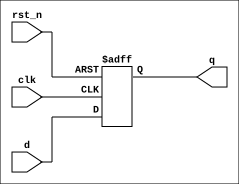

# VeriView 

**VeriView**, Verilog and SystemVerilog designs are instantly converted into professional, high-quality SVG schematics directly from the command line.

It acts as a wrapper around **Yosys** and **netlistsvg**, automating the entire flow: dependency installation, synthesis, JSON conversion, and schematic rendering.

## Features

- **Zero-Setup:** Automatically checks and installs missing dependencies (`yosys`, `nodejs`, `npm`, `netlistsvg`) on the first run.
- **Language Support:** Auto-detects **Verilog** (`.v`) and **SystemVerilog** (`.sv`).
- **File List Support:** Fully supports `.f` file lists with smart relative path resolution.
- **Dark Mode Friendly:** Forces a white background on the generated SVG for better visibility in dark-themed viewers.
- **WSL Integration:** Automatically opens the generated schematic in Windows Explorer if running on WSL.
- **Custom Output:** Define your own output filename and directory.

## Prerequisites

The script supports **Linux** (Debian/Ubuntu, Fedora, Arch) and **macOS**.
*Note: The script attempts to install these automatically if missing.*

- **Yosys** (Open Source Synthesis Suite)
- **Node.js & npm** (Required for netlistsvg)
- **netlistsvg** (The rendering engine)

## Installation

Simply download the script and make it executable.

```bash
# 1. Clone this repo
# 2. Give execution permission to file
chmod +x veriview.sh
```

## Usage

### Basic Syntax

```bash
./veriview.sh <input_file> [top_module] [options]
```

### Options

| Flag | Description |
| :--- | :--- |
| `-o`, `--output <path>` | Specify custom output filename/path (e.g., `./build/schematic.svg`). |
| `-h`, `--help` | Show the help message. |
| `-f`, `--flatten` | Flatten the design hierarchy (expand sub-modules). |

### Examples

**1. Single SystemVerilog File**
Generates `counter.svg` in the current directory.
```bash
./veriview.sh counter.sv
```

**2. Specifying a Top Module**
Useful if the file contains multiple modules.
```bash
./veriview.sh alu.v alu_top
```

**3. Using a File List (.f)**
Compiles all files listed in `design.f`.
```bash
./veriview.sh design.f cpu_core
```

**4. Custom Output Path**
Generates the SVG in a specific folder (creates folder if missing).
```bash
./veriview.sh cpu_top.sv -o ./results/my_cpu.svg
```

## Working with File Lists (.f)

VeriView supports standard `.f` files used in EDA tools.
- Supports **comments** (`//` or `#`).
- Supports **relative paths** (relative to the `.f` file's location).

**Example `design.f`:**

```text
// Interfaces
../pkg/types.sv

// Design Files
alu.sv
decoder.sv

// Top Level
cpu_top.sv
```
## Try with Example Designs

You can test the tool with the provided example designs to see how it handles different scenarios.

### 1. Run a Single SystemVerilog File
Synthesize a simple D-Flip Flop and save the output to the results folder.

```bash
./veriview.sh ex_design/dff.sv -o ./results/dff.svg
```

**Output:**
<br>

<br>

---

### 2. Run with a File List (.f)
Synthesize a Ripple Carry Adder (RCA) using a file list that includes sub-modules.

```bash
./veriview.sh ex_design/rca/rca.f -o ./results/rca.svg
```

**Output:**
<br>

<br>

---

### 3. Run with .f and Specific Top Module
Extract and synthesize only the Full Adder (`fa`) module from the same RCA file list.

```bash
./veriview.sh ex_design/rca/rca.f fa -o ./results/fa.svg
```

**Output:**
<br>

<br>

### 4. Flattened Hierarchy (Detailed View)
By default, sub-modules are shown as black boxes. Use `--flatten` to expand them and see the internal logic of the entire design.

```bash
./veriview.sh ex_design/rca/rca.f --flatten -o ./results/rca_flat.svg
```

**Output:**
<br>

<br>

## Troubleshooting

- **"Module Re-definition" Error:** Ensure you are not using `` `include `` directives inside your Verilog files if you are also listing them in a `.f` file.
- **Blank/Black Image:** The script automatically injects a white background. If you still see a black image, try opening it in a web browser (Chrome/Edge).

## License

This project is open-source. Feel free to modify and distribute.