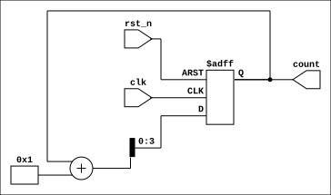
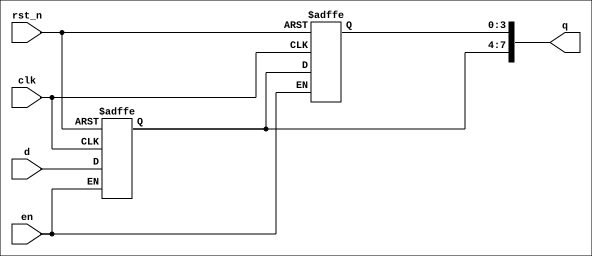
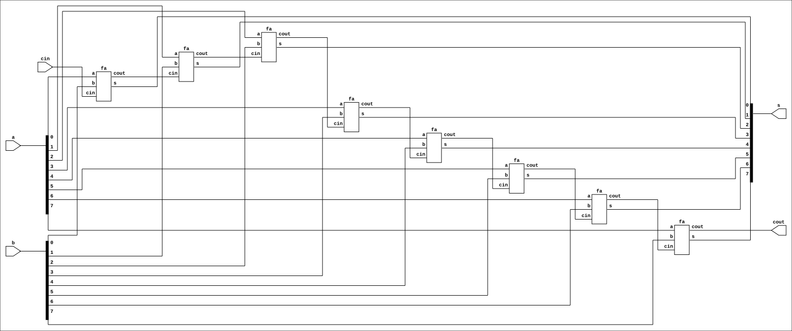
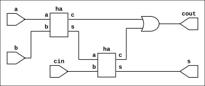
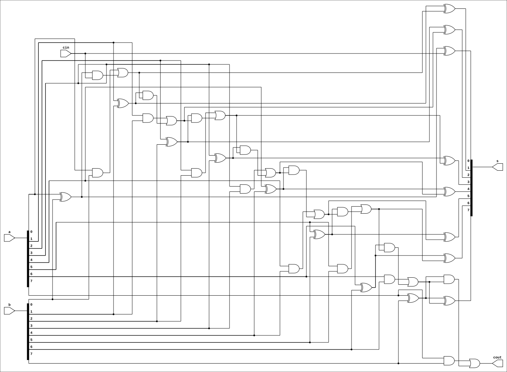
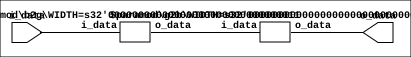
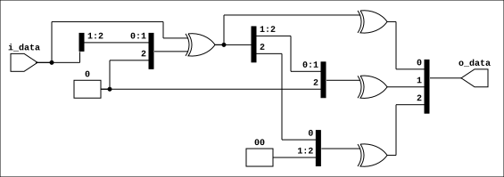
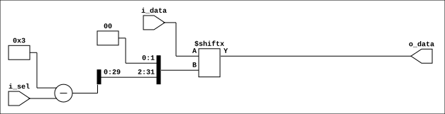

# VeriView

[](https://github.com/recepyazar/veriview/actions/workflows/ci.yml)

**VeriView** turns Verilog and SystemVerilog designs into SVG schematics from the command line.

It wraps **Yosys** and **netlistsvg** (plus, optionally, **sv2v** or **yosys-slang** for full SystemVerilog support): it reads your sources or `.f` file lists, synthesizes a netlist and renders it as an SVG.

## Features

- **Verilog & SystemVerilog** (`.v`, `.sv`) – auto-detected per file.
- **Full SystemVerilog via fallback frontends** – if Yosys' built-in parser can't handle a construct (e.g. unpacked array ports), VeriView automatically retries with [yosys-slang](https://github.com/povik/yosys-slang) or [sv2v](https://github.com/zachjs/sv2v).
- **File lists (`.f`)** – `+incdir+`, `+define+`, nested `-f`/`-F`, `-v`, `$VAR`/`${VAR}`/`$(VAR)` and comments.
- **Include dirs & defines** – `-I` and `-D` on the command line.
- **Hierarchy control** – keep sub-modules as boxes or `--flatten` them; `--split` renders one SVG per module.
- **Dark-mode friendly** – injects a background (`--bg white` by default, `--bg none` to disable).
- **Open the result** – `--open` uses `xdg-open`, macOS `open`, or Windows Explorer on WSL.
- **Optional dependency installer** – `--install-deps` installs Yosys, Node.js, netlistsvg and sv2v.

## Requirements

Linux (Debian/Ubuntu, Fedora, Arch), macOS or WSL with:

| Tool | Needed for |
| :--- | :--- |
| [Yosys](https://github.com/YosysHQ/yosys) | synthesis (required) |
| [netlistsvg](https://github.com/nturley/netlistsvg) + Node.js | rendering (required) |
| [sv2v](https://github.com/zachjs/sv2v) **or** [yosys-slang](https://github.com/povik/yosys-slang) | SystemVerilog beyond Yosys' built-in parser (optional) |

Install whatever is missing with:

```bash
./veriview.sh --install-deps      # asks before using sudo; add -y to skip the prompt
```

sv2v is installed to `~/.local/bin` without sudo. If dependencies are missing during a normal run, VeriView asks whether to install them (interactive terminals only).

## Installation

```bash
git clone https://github.com/recepyazar/veriview.git
cd veriview
chmod +x veriview.sh
./veriview.sh --install-deps
```

## Usage

```bash
./veriview.sh [options] <input>... [top_module]
```

`<input>` is one or more `.v`/`.sv` files and/or `.f` file lists.

| Option | Description |
| :--- | :--- |
| `-t`, `--top <name>` | Top module (default: auto-detected). The legacy positional form `veriview.sh design.f top` also works. |
| `-o`, `--output <path>` | Output SVG path (a path ending in `/` is treated as a directory). With `--split`: output directory. |
| `-f`, `-F <file.f>` | Read a file list. |
| `-I`, `--incdir <dir>` | Add an include directory (repeatable). |
| `-D`, `--define <N[=V]>` | Add a preprocessor define (repeatable). |
| `--flatten` | Flatten the hierarchy (expand sub-modules). |
| `--split` | Render every module into its own SVG. |
| `--frontend <name>` | `auto` (default), `yosys`, `sv2v` or `slang`. |
| `--skin <file.svg>` | Custom [netlistsvg skin](https://github.com/nturley/netlistsvg#skins). |
| `--bg <color\|none>` | Background color (default `white`). |
| `--keep-json` | Keep the Yosys JSON netlist next to the SVG. |
| `--open` | Open the generated SVG. |
| `--install-deps` | Install missing dependencies. |
| `-y`, `--yes` | Don't ask for confirmation when installing. |
| `-q`, `--quiet` | Only print warnings and errors. |
| `-V`, `--version` / `-h`, `--help` | Version / help. |

> **Breaking change in 4.0:** `-f` now means *file list* (as in other EDA tools). Use `--flatten` to flatten the hierarchy.

If `-o` is not given, the output is `<top_module>.svg` (when a top is given) or `<first_input_name>.svg` in the current directory.

### SystemVerilog frontends

With `--frontend auto`, VeriView first tries Yosys' built-in parser. If that fails and the sources contain SystemVerilog, it retries with **yosys-slang** (if the plugin is installed), then **sv2v** (if installed). This handles constructs such as unpacked array ports:

```systemverilog
input logic [DATA_WIDTH-1:0] i_data [NUM_INPUTS],
```

sv2v converts these into packed vectors, so in the schematic they appear as one wide bus (e.g. `i_data[15:0]`).

## File lists (.f)

```text
// comments with // or #
+incdir+../include+$(PROJ)/common/include
+define+SYNTHESIS+WIDTH=8

../pkg/types.sv
alu.sv
decoder.sv
-f ${PROJ}/ip/fifo.f        // nested file list
-v lib/cells.v              // library file
cpu_top.sv
```

- Relative paths are resolved against the directory of the `.f` file.
- Environment variables are expanded (`$VAR`, `${VAR}`, `$(VAR)`).
- `-y` and `+libext+` are ignored with a warning.

## Examples

Example designs live in `ex_design/`:

| Path | Description |
| :--- | :--- |
| `counter.sv` | Parameterized up-counter |
| `shift_reg.sv` | Parameterized shift register with enable; unpacked array output (needs sv2v or yosys-slang) |
| `seqdect.sv` | Serial sequence detector with an elaboration-time parameter check |
| `rca/` (`rca.f`) | Ripple-carry adder built from full/half adders (hierarchical) |
| `gray/` (`gray.f`) | Binary→Gray→Binary round trip (`b2g2b`), optimizes to a pass-through when flattened |
| `mux/mux_basic.sv` | 2:1 multiplexer |
| `mux/mux.sv` | N:1 multiplexer with unpacked array ports (needs sv2v or yosys-slang) |

All results below are generated with `make examples`.

**Single file**

```bash
./veriview.sh ex_design/counter.sv -o results/counter.svg
```



**Shift register with an unpacked array output (needs sv2v or yosys-slang)**

```bash
./veriview.sh ex_design/shift_reg.sv -o results/shift_reg.svg
```



**File list (hierarchical)**

```bash
./veriview.sh ex_design/rca/rca.f -o results/rca.svg
```



**File list with a specific top module**

```bash
./veriview.sh ex_design/rca/rca.f -t fa -o results/fa.svg
```



**Flattened hierarchy**

```bash
./veriview.sh ex_design/rca/rca.f --flatten -o results/rca_flat.svg
```



**Gray code round trip (hierarchical vs. flattened)**

```bash
./veriview.sh ex_design/gray/gray.f -o results/b2g2b.svg
./veriview.sh ex_design/gray/gray.f --flatten -o results/b2g2b_flat.svg
```




**One SVG per module**

```bash
./veriview.sh ex_design/rca/rca.f --split -o results/split/
```

**Unpacked array ports (needs sv2v or yosys-slang)**

```bash
./veriview.sh ex_design/mux/mux.sv -o results/mux.svg
```



## Development

```bash
make test       # run the test suite (tests/run_tests.sh)
make lint       # shellcheck
make examples   # regenerate results/*.svg
```

CI runs lint and tests on every push and pull request.

## Troubleshooting

- **`syntax error` on valid SystemVerilog** – Yosys' built-in parser supports only part of SystemVerilog. Install sv2v (`./veriview.sh --install-deps`) or yosys-slang.
- **"Module re-definition" error** – don't `` `include `` source files that are also listed in the `.f` file.
- **Black/blank image** – VeriView injects a white background by default; if your viewer still shows black, open the SVG in a web browser.

## License

[MIT](LICENSE)
